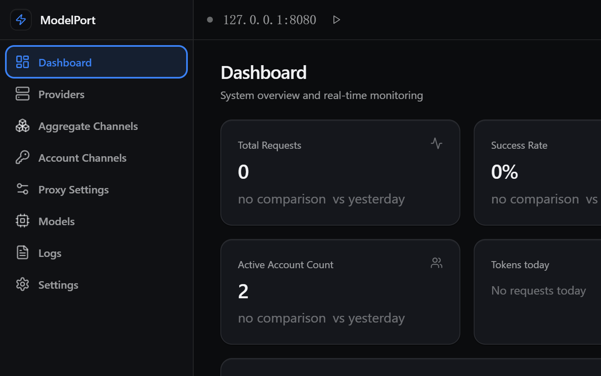

# ModelPort

<p align="center">
  
</p>

<p align="center">
  
  
  <br>
  <a href="https://www.electronjs.org/"></a>
  <a href="https://react.dev/"></a>
  <a href="https://www.typescriptlang.org/"></a>
  
</p>

<p align="center">
  <strong><a href="README_CN.md">中文</a> | <a href="https://github.com/polite0803/ModelPort">GitHub</a> | <a href="https://github.com/polite0803/ModelPort/releases">Releases</a></strong>
</p>

<p align="center">
  <strong>One local port for every model you own.</strong>
</p>

<p align="center">
  ModelPort is an Electron desktop application that runs an OpenAI-compatible API gateway on your
  machine. It ships an aggregate catalogue of 89 endpoints / 570 models, thirteen account channels
  managed by a vendored channel pack, and user-defined custom providers, so one base URL serves any
  OpenAI-compatible SDK or agent client.
</p>



## Core capabilities

- **OpenAI-compatible API.** `POST /v1/chat/completions`, `POST /v1/completions`, `GET /v1/models`
  and `GET /v1/models/:model`. Inbound Anthropic `/v1/messages` and Codex Responses `/v1/responses`
  are translated onto the same routing, failover, quota and logging path. A management HTTP API
  lives under `/v1/management/*`.
- **Three provider classes.** 89 aggregate entries (key-based, key-less, and `unsupported` entries
  that need Google ADC), thirteen account channels with their own account pools and credit
  accounting, and custom providers pointing at any OpenAI-compatible endpoint.
- **Failover and routing.** Round-robin, fill-first, failover, smart and pace strategies, plus a
  virtual `auto` model that picks a candidate by capability, context size and live health. Client
  errors are terminal; 401/403/404/5xx and network failures move to the next candidate, and a 404
  switches without cooling down the account.
- **Quota awareness.** A generated aggregate free-quota ledger, a live per-account credit gate,
  per-`(account, model)` AIMD concurrency admission, a 24-hour bandit score, and a second
  content-degenerate stream detector. Exhausted candidates are a last resort, never a forced pick.
  Missing upstream `usage` stays `null`; the gateway does not invent token counts.
- **Context handling without prompt injection.** History trimming is deletion-only (sliding window
  or token limit) and never empties the conversation. Optional live-zone compression saves tokens
  without adding a system or user turn. Tool definitions and replies travel natively; the gateway
  does not render tool descriptions into a prompt or parse prose back into `tool_calls`.
- **HTTPS and certificate trust.** An optional TLS listener (default `8443`) uses a managed
  self-signed certificate or a custom PEM pair. The app can install the certificate into the OS
  trust store for Chromium/Schannel clients, print the `NODE_EXTRA_CA_CERTS` line that Node clients
  need, and serve the same PEM from `GET /v1/management/tls/ca`. Handshake rejections are counted in
  `TlsStatus` because a refused handshake produces no request row.
- **Diagnostics.** Every `/v1/*` response carries `X-Request-Id`; request logs record each attempt,
  stream trace, upstream status and request id. `X-ModelPort-Trace: 1` captures bodies for one
  request even when global body logging is off, and the Logs detail dialog can export a diagnostic
  bundle.
- **Desktop UI.** Dashboard, provider and account-channel pages, model catalogue, API keys, request
  logs, proxy settings, tray integration, and English / Simplified Chinese locales.

## Supported providers

| Provider class | Auth types | Count | Notes |
| -------------- | ---------- | ----- | ----- |
| Aggregate catalogue | API key / none / unsupported | 89 entries / 570 models | `openai-chat` and `anthropic-messages` wires; includes Kilo's key-less free pool |
| Account channels | Browser / device-code / OAuth / API key | 13 channels | Each channel keeps its own account pool, daily credit claim and model gating |
| Custom provider | Configured per provider | — | Any OpenAI-compatible HTTP endpoint you define yourself |

The aggregate catalogue is browsable in the **Aggregate Channels** page, which lists each entry with
its category, wire protocol and model count. Saving an entry creates a provider record with
namespaced model names (`provider/model`); entries you never save never appear in the provider
list. Entries whose base URL contains `{placeholders}` (Azure, Vertex) must be overridden before
they can be saved.

The **Account Channels** page covers `lobsterai`, `qoder`, `qodercn`, `trae`, `cline`, `loomy`,
`raccoon`, `minimax`, `zcode`, `gemini`, `workbuddy`, `buddy` and `opencode`. Model names carry the
upstream credit multiplier in one of three shapes (`· x4.0`, `· x0.2→x0.1`, `· 免费`), free models
are badged, and a model the upstream no longer reports as healthy can be restored from the same
panel. The `opencode` channel is the API-key exception: it accepts an anonymous slot or a pasted
`sk-` key and opens no browser.

Provider adaptation notes are in [docs/providers](docs/providers/README.md).

## Quick start

### Download

Download the latest release from [GitHub Releases](https://github.com/polite0803/ModelPort/releases):

| Platform | Artifact |
| -------- | -------- |
| macOS (Apple Silicon) | `ModelPort-<version>-mac-arm64.dmg` |
| Windows (x64) | `ModelPort-<version>-x64-setup.exe`, or the portable `.exe` |
| Linux (x64) | `ModelPort-<version>-x64.AppImage`, `.deb`, or `.tar.gz` |
| Linux (arm64) | `ModelPort-<version>-arm64.AppImage` |
| WSL / headless Linux | `modelport-daemon-<version>-<arch>.tar.gz` |

The installer is a **console**, not just a gateway. It runs the gateway on this machine
(local mode), installs and upgrades one inside WSL, or connects to a gateway on another
host. Local and WSL modes provision the gateway when it does not exist yet - the local
gateway ships inside the same binary, the WSL one is downloaded, verified and enabled as
a systemd unit.

One console keeps every gateway in one place: the tray (or `Ctrl+Shift+G`) opens **网关管理**,
a list with each gateway's mode, state and version, and the actions that fit it - connect /
edit / delete, start / stop / repair for the local one, install for WSL. Clicking a row
switches the window to that gateway.

Release builds are not code-signed and the macOS build is not notarized. On macOS the quarantine
attribute can be cleared with the command in the [FAQ](#faq).

### Build from source

Requirements: Node.js 22.18+ (24 recommended), npm, and Git.

```bash
git clone https://github.com/polite0803/ModelPort.git
cd ModelPort
npm install

npm run dev      # macOS / Linux
npm run dev:win  # Windows (sets the console code page, builds the channel pack)
```

## Run the gateway

1. Add a provider. Use **Aggregate Channels** for a catalogue entry, **Account Channels** for a
   login channel, or **Providers** to define a custom OpenAI-compatible endpoint.
2. Open **Proxy Settings**. The default listener is `127.0.0.1:8080`; HTTPS is off by default and
   uses port `8443` when enabled.
3. Optionally create an API key under **API Keys**. Once any enabled key exists, every `/v1/*`
   request needs `Authorization: Bearer <key>` or `X-API-Key: <key>`. With no key configured the
   server binds loopback only and refuses a non-loopback host.

```python
from openai import OpenAI

client = OpenAI(
    api_key="your-api-key",          # any non-empty value when no key is configured
    base_url="http://127.0.0.1:8080/v1",
)

response = client.chat.completions.create(
    model="kilo/kilo-auto/free",
    messages=[{"role": "user", "content": "Hello, who are you?"}],
)

print(response.choices[0].message.content)
```

## Configuration and data

Application data lives in `~/.modelport/`. The Electron profile directory is pinned to
`<appData>/modelport`, because `safeStorage` seals `store.key` and credentials against that path;
moving it would make an existing install unreadable.

- `data.json` - one electron-store file holding config, providers, accounts, sessions, statistics
  and app logs (there is no separate `providers.json` or `accounts.json`)
- `store.key` - this install's data key, sealed by the OS keystore
- `request-logs/` - detailed request logs
- `quota-ledger.json` - aggregate free-quota counters and the caps learned from upstream
- `channel-pack/` - the channel pack's own state plus encrypted channel credentials
- `tls/` - the managed self-signed certificate and key

Credentials use `safeStorage` when it is available. If it is not, the data file is written
unencrypted and a warning is logged, so restrict access to `~/.modelport/` in that case.

## Platform support

| Platform | Architectures | Packages |
| -------- | ------------- | -------- |
| macOS | Apple Silicon (arm64) | DMG only |
| Windows | x64 | NSIS installer, portable executable |
| Linux | x64, arm64 | AppImage; x64 also `.deb` and `.tar.gz` |
| WSL / headless Linux | x64, arm64 | `modelport-daemon-<ver>-<arch>.tar.gz`: the gateway without Electron (bundle + resources + UI + a systemd unit template) |
| Gateway modes | Windows: local, WSL, remote; macOS/Linux: local, remote | The console starts a windowless local gateway, installs one inside WSL, or connects to a remote gateway. A WSL/headless host runs the daemon tarball instead of the console. |

## Development and verification

```bash
npm run build              # source-artifact guard + channel pack + electron-vite build
npm run gate               # what CI runs: build + both tsc programs + full test suite
npm run build:mac          # dmg only
npm run build:win          # NSIS + portable
npm run build:linux        # AppImage, deb, tar.gz
npm run build:daemon       # headless Node bundle (out/daemon) + dist/modelport-daemon-<ver>-<arch>.tar.gz
```

Windows installers are packaged by CI, not locally: to write the uninstaller, electron-builder
launches the NSIS stub it just compiled (`NsisTarget.js` → `execWine`), and that child is killed on
this dev host, so `build:win` stops at
`Command failed: dist…\…-setup.exe` with the 223 KB stub left in place. It is not a config
difference. Use `electron-builder --dir` for an unpacked build, and `npx electron .` to run
the console without any installer.

`npm run gate` runs `tsc --noEmit` against both `tsconfig.json` (renderer + shared) and
`tsconfig.node.json` (main + preload + shared), then the Node test suite under `tests/`.
`electron-vite build` transpiles without type checking, so a green build alone is not evidence that
the types are clean. The test runner needs a Node that strips TypeScript natively (22.18+, 23.6+,
or 24); older 22.x releases fail with `ERR_UNKNOWN_FILE_EXTENSION`.

## Documentation

| Document | Contents |
| -------- | -------- |
| [docs/README.md](docs/README.md) | Documentation index: design, plan, audit, and references |
| [AGENTS.md](AGENTS.md) | Short rulebook: build gate, architecture, invariants |
| [docs/AGENTS-full.md](docs/AGENTS-full.md) | Full subsystem reference and the failure behind each rule |
| [docs/providers/README.md](docs/providers/README.md) | Provider classes, aggregate flow, account channels |
| [docs/design/](docs/design/) | Design and decision records for subsystems |
| [docs/plan/](docs/plan/) | Phased implementation and migration plans |
| [docs/audit/](docs/audit/) | Audit reports, field evidence and gate readings |
| [CODE_WIKI.md](CODE_WIKI.md) | Legacy overview; `AGENTS.md` and `AGENTS-full.md` take precedence |

## FAQ

### macOS says the app is damaged and cannot be opened

Apps downloaded outside the App Store can trigger this warning. Clear the quarantine attribute:

```bash
sudo xattr -rd com.apple.quarantine "/Applications/ModelPort.app"
```

### How do I update?

Check for updates on the **About** page, or download the latest release from
[GitHub Releases](https://github.com/polite0803/ModelPort/releases).

## Contributing

1. Fork the project and create a feature branch.
2. Make the change and run `npm run gate`.
3. Open a pull request with the gate output.

## License

GNU General Public License v3.0. See [LICENSE](LICENSE).

## Acknowledgements

- [Electron](https://www.electronjs.org/) - cross-platform framework
- [React](https://react.dev/) - UI framework
- [TypeScript](https://www.typescriptlang.org/) - typed JavaScript
- [Tailwind CSS](https://tailwindcss.com/) - CSS framework
- [Zustand](https://zustand-demo.pmnd.rs/) - state management
- [Koa](https://koajs.com/) - HTTP server
