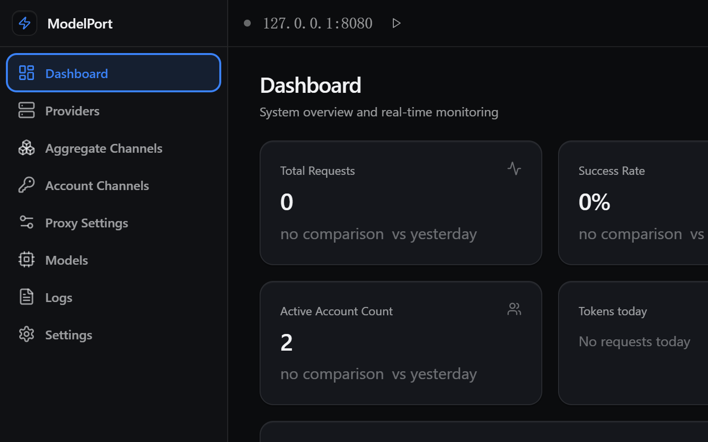

# ModelPort

<p align="center">
  
</p>

<p align="center">
  
  
  <br>
  <a href="https://www.electronjs.org/"></a>
  <a href="https://react.dev/"></a>
  <a href="https://www.typescriptlang.org/"></a>
  
</p>

<p align="center">
  <strong><a href="README.md">English</a> | <a href="https://github.com/polite0803/ModelPort">GitHub</a> | <a href="https://github.com/polite0803/ModelPort/releases">Releases</a></strong>
</p>

<p align="center">
  <strong>一个本地端口，接上你所有的模型。</strong>
</p>

<p align="center">
  ModelPort 是一个运行在本机的 Electron 桌面应用，对外提供 OpenAI 兼容的 API 网关。它内置
  92 条聚合渠道 / 580 个模型、13 个由随附渠道包管理的账号渠道，以及用户自定义供应商；一个
  Base URL 即可对接任意 OpenAI 兼容 SDK 或 Agent 客户端。
</p>



## 核心能力

- **OpenAI 兼容 API。** 提供 `POST /v1/chat/completions`、`POST /v1/completions`、
  `GET /v1/models` 和 `GET /v1/models/:model`。入站的 Anthropic `/v1/messages` 与 Codex
  Responses `/v1/responses` 会转换到同一套路由、故障转移、配额和日志链路上。管理接口位于
  `/v1/management/*`。
- **三类供应商。** 89 条聚合渠道（带 Key、免密，以及需要 Google ADC 的 `unsupported` 条目）、
  13 个拥有独立账号池与积分账本的账号渠道，以及指向任意 OpenAI 兼容端点的自定义供应商。
- **故障转移与路由。** 支持轮询、填充优先、故障转移、智能、匀速五种策略，并提供虚拟 `auto`
  模型按能力、上下文长度和实时健康度选路。客户端自身造成的错误不会重试；401/403/404/5xx
  与网络错误会切到下一个候选，404 会切换但不给账号降温。
- **配额感知。** 聚合渠道的免费额度账本、账号的实时积分门槛、按 `(账号, 模型)` 的 AIMD 并发
  准入、24 小时 Bandit 评分，以及第二类“内容退化流”检测。额度耗尽的候选只在最后兜底，不会
  被强行选中。上游没有返回 `usage` 时保持 `null`，网关不编造 token 数。
- **不注入提示词的上下文处理。** 历史裁剪只做删除（滑动窗口或 Token 上限），永不清空对话；
  可选的实时区压缩节省 token，但不新增 system 或 user 轮次。工具定义与工具回复原生透传，
  网关不会把工具描述渲染进提示词，也不会把文本回复解析成 `tool_calls`。
- **HTTPS 与证书信任。** 可选 TLS 监听（默认 `8443`），使用托管的自签名证书或自定义 PEM
  证书对。应用可把证书装进操作系统信任库以服务 Chromium/Schannel 客户端，给出 Node 客户端
  需要的 `NODE_EXTRA_CA_CERTS` 行，并通过 `GET /v1/management/tls/ca` 提供同一份 PEM。
  握手被拒不会产生请求行，因此 `TlsStatus` 单独记录握手拒绝次数。
- **诊断。** 每个 `/v1/*` 响应都带 `X-Request-Id`；请求日志记录每次尝试、流式轨迹、上游状态
  与上游请求 ID。`X-ModelPort-Trace: 1` 可在全局正文日志关闭时单独抓取一次请求的正文，日志
  详情弹窗还能导出诊断包。
- **桌面界面。** 仪表盘、供应商与账号渠道、模型目录、API Key、请求日志、代理设置、系统托盘，
  以及英文 / 简体中文两种界面语言。

## 支持的供应商

| 供应商类别 | 认证方式 | 数量 | 说明 |
| ---------- | -------- | ---- | ---- |
| 聚合目录 | API Key / 免密 / 不支持 | 92 条 / 580 个模型 | `openai-chat` 与 `anthropic-messages` 两种线路；含 Kilo 免密免费池 |
| 账号渠道 | 浏览器 / 设备码 / OAuth / API Key | 15 个渠道 | 每个渠道维护自己的账号池、每日积分领取与模型门禁 |
| 自定义供应商 | 按供应商自行配置 | — | 任意你定义的 OpenAI 兼容 HTTP 端点 |

聚合目录可在**聚合渠道**页面浏览，每条会列出类别、线路协议和模型数。保存一条渠道会生成带
命名空间的模型名（`provider/model`）的供应商记录；没有保存的条目不会出现在供应商列表里。
Base URL 含 `{placeholders}` 的条目（Azure、Vertex）必须先覆盖端点才能保存。

**账号渠道**页面覆盖 `lobsterai`、`qoder`、`qodercn`、`trae`、`cline`、`loomy`、`raccoon`、
`minimax`、`zcode`、`gemini`、`workbuddy`、`buddy` 和 `opencode`。模型名会带上游的积分倍率，
共三种形态（`· x4.0`、`· x0.2→x0.1`、`· 免费`），免费模型单独标注；上游不再报告健康的模型
也可以在同一面板恢复。`opencode` 渠道是其中的 API Key 例外：它接受匿名槽位或粘贴 `sk-`
密钥，不打开浏览器。

供应商适配说明见 [docs/providers](docs/providers/README.md)。

## 快速开始

### 下载安装

从 [GitHub Releases](https://github.com/polite0803/ModelPort/releases) 下载最新版本：

| 平台 | 产物 |
| ---- | ---- |
| macOS（Apple Silicon） | `ModelPort-<version>-mac-arm64.dmg` |
| Windows（x64） | `ModelPort-<version>-x64-setup.exe`，或便携版 `.exe` |
| Linux（x64） | `ModelPort-<version>-x64.AppImage`、`.deb` 或 `.tar.gz` |
| Linux（arm64） | `ModelPort-<version>-arm64.AppImage` |
| WSL / 无头 Linux | `modelport-daemon-<version>-<arch>.tar.gz` |

安装包是一个**控制台**，不只是网关：它可以在这台机器上运行网关（本地形态）、在 WSL
里安装并升级网关（WSL 形态），或者连接另一台机器上的网关（远程形态）。本地与 WSL
形态都会在网关不存在时完成安装——本地网关就在同一个二进制里，WSL 那份会下载、
校验并以 systemd 单元启用。

一个控制台可以同时管多台网关：托盘或 `Ctrl+Shift+G` 打开**网关管理**，列表里带形态、
运行状态与版本，按形态给不同动作（连接／编辑／删除，本机的启动／停止／修复，WSL 的安装）。
点一行就切到那台网关。

发布产物没有代码签名，macOS 版本也没有公证。macOS 的隔离属性可以用
[常见问题](#常见问题)里的命令清除。

### 从源码构建

环境要求：Node.js 22.18+（推荐 24）、npm、Git。

```bash
git clone https://github.com/polite0803/ModelPort.git
cd ModelPort
npm install

npm run dev      # macOS / Linux
npm run dev:win  # Windows（设置控制台代码页并构建渠道包）
```

## 运行网关

1. 添加供应商。聚合渠道用**聚合渠道**页面，登录渠道用**账号渠道**页面，自定义端点用
   **供应商**页面。
2. 打开**代理设置**。默认监听 `127.0.0.1:8080`；HTTPS 默认关闭，开启时使用 `8443` 端口。
3. 如需鉴权，在 **API Keys** 页面创建密钥。只要存在任何一个启用的密钥，所有 `/v1/*` 请求都
   必须带 `Authorization: Bearer <key>` 或 `X-API-Key: <key>`。没有配置密钥时，服务只绑定
   回环地址，并拒绝非回环主机。

```python
from openai import OpenAI

client = OpenAI(
    api_key="your-api-key",          # 未配置密钥时，任意非空值即可
    base_url="http://127.0.0.1:8080/v1",
)

response = client.chat.completions.create(
    model="kilo/kilo-auto/free",
    messages=[{"role": "user", "content": "你好，你是谁？"}],
)

print(response.choices[0].message.content)
```

## 配置与数据目录

应用数据存放在 `~/.modelport/`。Electron 的 profile 目录固定为 `<appData>/modelport`，因为
`store.key` 由 `safeStorage` 绑定在该路径上；移动目录会让已有安装无法解密。

- `data.json` - 单一 electron-store 文件，保存配置、供应商、账号、会话、统计与应用日志
  （没有单独的 `providers.json` 或 `accounts.json`）
- `store.key` - 本机数据密钥，由操作系统密钥库封装
- `request-logs/` - 请求明细日志
- `quota-ledger.json` - 聚合免费额度计数与从上游学到的额度上限
- `channel-pack/` - 渠道包自身状态，以及加密后的渠道凭证
- `tls/` - 托管的自签名证书与私钥

系统密钥库可用时，凭证通过 `safeStorage` 加密。不可用时，数据文件会以明文写入并产生告警，
此时应限制 `~/.modelport/` 的访问权限。

## 平台支持

| 平台 | 架构 | 安装包 |
| ---- | ---- | ------ |
| macOS | Apple Silicon（arm64） | 仅 DMG |
| Windows | x64 | NSIS 安装包、便携版可执行文件 |
| Linux | x64、arm64 | AppImage；x64 另有 `.deb` 与 `.tar.gz` |

## 开发与验证

```bash
npm run build              # 源码产物守卫 + 渠道包 + electron-vite 构建
npm run gate               # CI 实际执行：构建 + 两个 tsc + 全量测试
npm run build:mac          # 仅 dmg
npm run build:win          # NSIS + 便携版
npm run build:linux        # AppImage、deb、tar.gz
```

`npm run gate` 会分别对 `tsconfig.json`（渲染进程 + shared）和 `tsconfig.node.json`
（主进程 + preload + shared）执行 `tsc --noEmit`，然后运行 `tests/` 下的 Node 测试套件。
`electron-vite build` 只转译、不做类型检查，所以“构建通过”不能证明类型干净。测试运行器需要
原生支持 TypeScript 剥离的 Node（22.18+、23.6+ 或 24）；更早的 22.x 会以
`ERR_UNKNOWN_FILE_EXTENSION` 失败。

## 文档

| 文档 | 内容 |
| ---- | ---- |
| [docs/README.md](docs/README.md) | 文档索引：方案、计划、审计与参考资料 |
| [AGENTS.md](AGENTS.md) | 简版规则：构建门禁、架构与不可破坏的约束 |
| [docs/AGENTS-full.md](docs/AGENTS-full.md) | 完整子系统参考，以及每条规则背后的故障 |
| [docs/providers/README.md](docs/providers/README.md) | 供应商类别、聚合流程、账号渠道 |
| [docs/design/](docs/design/) | 子系统设计与决策记录 |
| [docs/plan/](docs/plan/) | 分阶段实施与迁移计划 |
| [docs/audit/](docs/audit/) | 审计报告、实测证据与门禁读数 |
| [CODE_WIKI.md](CODE_WIKI.md) | 较早的概览；与 `AGENTS.md`、`AGENTS-full.md` 冲突时以后者为准 |

## 常见问题

### macOS 提示“应用已损坏，无法打开”

从 App Store 之外下载的应用可能触发该提示。清除隔离属性即可：

```bash
sudo xattr -rd com.apple.quarantine "/Applications/ModelPort.app"
```

### 如何更新？

在**关于**页面检查更新，或从
[GitHub Releases](https://github.com/polite0803/ModelPort/releases) 下载最新版本。

## 贡献

1. Fork 项目并创建功能分支。
2. 完成改动并运行 `npm run gate`。
3. 提交 Pull Request，并附上门禁输出。

## 许可证

GNU 通用公共许可证 v3.0。详见 [LICENSE](LICENSE)。

## 致谢

- [Electron](https://www.electronjs.org/) - 跨平台框架
- [React](https://react.dev/) - UI 框架
- [TypeScript](https://www.typescriptlang.org/) - 类型安全的 JavaScript
- [Tailwind CSS](https://tailwindcss.com/) - CSS 框架
- [Zustand](https://zustand-demo.pmnd.rs/) - 状态管理
- [Koa](https://koajs.com/) - HTTP 服务器
